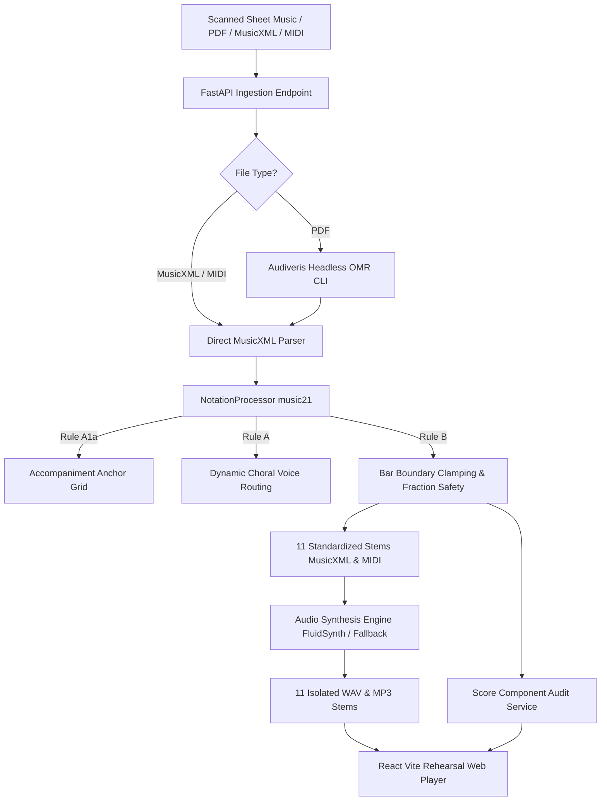

# PartTrackr 🎵

**Automated Choral OMR, Stem Isolation, & Rehearsal Player Microservice**

PartTrackr is an audio-music microservice that converts scanned choral sheet music (PDF, MusicXML, XML, MXL, MIDI) into **11 standardized rehearsal stems**, provides metric lockstep audio synthesis, and serves a modern, dark-themed responsive multi-track web rehearsal player.

---

## 🌟 Key Features

1. **The 11 Rehearsal Stem Taxonomy**:
   Every score is analyzed and separated into 11 discrete rehearsal stems:
   - `Piano`: Piano / Keyboard Accompaniment
   - `S1`: Soprano I
   - `S2`: Soprano II
   - `A1`: Alto I
   - `A2`: Alto II
   - `T1`: Tenor I
   - `T2`: Tenor II
   - `Bar1`: Baritone I
   - `Bar2`: Baritone II
   - `B1`: Bass I
   - `B2`: Bass II

2. **Strict Musical Rules & Ground Truth Intelligence**:
   - **Rule A: Visual Bracket Cues & Dynamic Choral Voice Routing**:
     - Straight bracket `[`: groups vocal choral staves.
     - Curvy bracket / brace `{`: groups piano accompaniment staves.
     - **Rule A1a**: Accompaniment-first timing anchor — extraction anchors to the accompaniment (when available) as the foundational metric and measure grid.
     - **Men's Unison**: Single Bass Clef (F-Clef) under straight bracket routed identically to all male parts (`T1, T2, Bar1, Bar2, B1, B2`); female parts rest.
     - **Women's Unison**: Single Treble Clef (G-Clef) under straight bracket routed identically to all female parts (`S1, S2, A1, A2`); male parts rest.
     - **Divisi & Polyphony Separation**: Upper stems/pitches routed to Voice 1, lower to Voice 2.
     - **2-Staff SA + TB Routing**: Staff 1 to female voices, Staff 2 to male voices.
     - **4-Staff Discrete SATB**: Direct section-to-stem routing.
     - **Interlude Suppression**: When only the keyboard is active, all 10 vocal parts contain whole-measure rests, eliminating OMR voice bleed.
     - **Rule A5 Ground Truth Integrity**: Zero hallucinated notes for the piano — accompaniment matches printed score notes verbatim.
   - **Rule B: Metric Lockstep Synchronization & Duration Clamping**:
     - **Bar Boundary Clamping**: Overflowing notes past the printed time signature duration (e.g., half note on beat 3 of 3/4 time) are clamped to preserve phase alignment.
     - **Underflow Rest Padding**: Short measures are padded with precise rests up to exact bar duration.
     - **Fractional Duration Preservation**: Native `Fraction` representations prevent tuplet rounding drift and export errors.
     - **Zero Cumulative Drift**: All 11 stems have identical measure counts ($M$) and exact matching durations down to 0.01 seconds.

3. **Multi-Track Web Rehearsal Player**:
   - 11-channel console with independent Volume, Stereo Pan, Solo, and Mute per channel.
   - Master volume, playback speed ($0.5\times$ to $1.5\times$), and A/B Loop markers.
   - Measure timeline seek bar with printed bar annotations and vocal activity dots.
   - "My Part" singer selection with **"Jump to Next Entrance"** navigation.
   - Built-in Score Component Audit Modal verifying match integrity %, accompaniment continuity, and lockstep sync.

4. **Multi-Engine Audio Synthesis**:
   - High-fidelity FluidSynth + SoundFont synthesis (`fluid-soundfont-gm` / `GeneralUser GS`).
   - Pure-Python harmonic synthesizer fallback (zero external dependencies required for testing on any OS).

---

## 🏗️ Architecture & Tech Stack



- **Backend**: Python 3.11+, FastAPI, SQLAlchemy, Pydantic v2, `music21`, `mido`, `numpy`, `scipy`.
- **OMR**: Audiveris Headless CLI.
- **Synthesis**: FluidSynth, ffmpeg, SoundFonts (`.sf2`).
- **Frontend**: React 19, TypeScript, Vite, Tailwind CSS v4, Lucide Icons, Web Audio API.
- **Containerization**: Multi-stage `Dockerfile`, `docker-compose.yml`.

---

## 🚀 Quick Start (Docker Deployment)

Launch the entire stack with a single command:

```bash
docker compose up --build
```

The microservice and web rehearsal player will be available at:
`http://localhost:8000`

Health check endpoint:
`http://localhost:8000/health`

---

## 💻 Local Development Setup

### 1. Backend Setup
```bash
# Create and activate virtual environment
python -m venv venv
.\venv\Scripts\activate   # Windows
# or source venv/bin/activate # Linux/macOS

# Install dependencies
pip install -r requirements.txt

# Run backend
uvicorn app.main:app --host 0.0.0.0 --port 8000 --reload
```

### 2. Frontend Setup
```bash
cd frontend
npm install
npm run dev
```
Open `http://localhost:3000` to access the Vite dev server with proxy to backend port 8000.

### 3. Build Frontend for Production
```bash
cd frontend
npm run build
```
FastAPI automatically serves the built frontend SPA from `frontend/dist`.

---

## 🧪 Automated Testing

Run the comprehensive automated unit and integration test suite:

```bash
python -m pytest -v
```

### Verified Test Matrix:
- `test_extract_all_11_stems`: Verifies all 11 standardized stems extract cleanly.
- `test_piano_ground_truth_no_hallucination`: Verifies zero hallucinated notes in accompaniment.
- `test_zero_measure_drift`: Verifies exact lockstep quarterLength matching across all stems.
- `test_overflow_bar_boundary_clamping`: Tests clamping of overflowing notes past bar limits.
- `test_underflow_padding`: Tests padding of underfilled measures with rests.
- `test_tuplet_fraction_safety`: Tests native `Fraction` tuplet durations.
- `test_unison_voice_routing`: Tests dynamic Men's unison and Women's unison voice routing.
- `test_interlude_cleanliness_suppression`: Tests complete suppression of OMR bleed during keyboard interludes.
- `test_divisi_chord_separation`: Tests upper/lower voice separation of chords.
- `test_audio_synthesizer_render_and_lockstep_duration`: Tests audio rendering and duration accuracy.
- `test_score_audit_report`: Tests score diagnostics and match integrity %.
- `test_health_endpoint`: Tests `/health` REST endpoint.
- `test_load_sample_score_endpoint`: Tests instant sample score loading and processing.
- `test_upload_score_endpoint`: Tests multipart sheet music upload pipeline.

---

## 📡 REST API Reference

### 1. Upload Sheet Music
`POST /api/v1/scores/upload`
- Multipart form-data with `file`: `.pdf`, `.musicxml`, `.xml`, `.mxl`, `.mid`.
- Returns `ScoreResponse` with measure grid, 11 stems metadata, and audit report.

### 2. Load Sample Score
`POST /api/v1/scores/sample/{sample_key}`
- `sample_key`: `anthem` (SATB + Piano intro/interlude & divisi) or `unison` (Men/Women unison lines).

### 3. List Scores
`GET /api/v1/scores`
- Returns list of uploaded scores with metadata.

### 4. Get Score Details
`GET /api/v1/scores/{score_id}`
- Returns full score response, analysis JSON, and audit diagnostics.

### 5. Stream Audio or Download Notation Stem
`GET /api/v1/scores/{score_id}/stems/{file_name}`
- Examples:
  - `/api/v1/scores/{id}/stems/Piano.mp3`
  - `/api/v1/scores/{id}/stems/S1.musicxml`
  - `/api/v1/scores/{id}/stems/T1.mid`

---

## 📜 License

MIT License. Designed and built with Google Antigravity.
